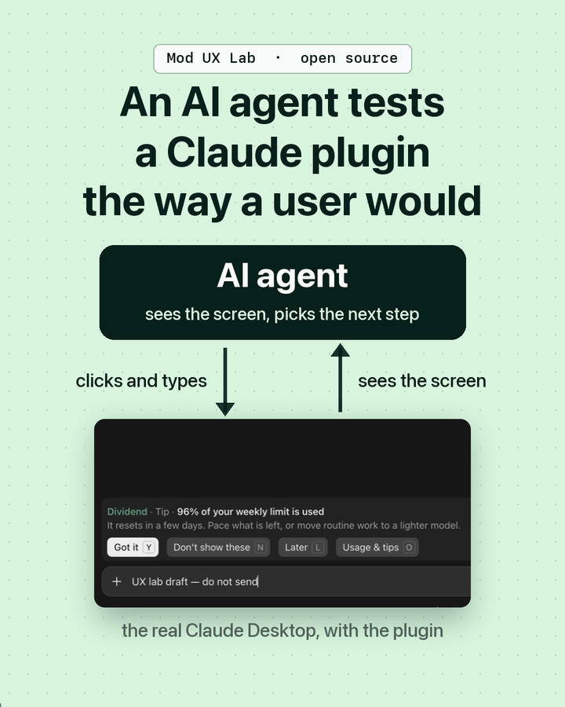

# AI'ing better - community by Mint

Small tools for working with AI agents.

We work with AI agents all day and keep building things to make that better. We're about to publish the ones we keep using here, starting with Dividend and Pair - take what's useful, and tell us what's missing.

## Claude Code marketplace

| Plugin | What it's for |
|---|---|
| [Dividend](plugins/dividend) | A Claude Code [mod](https://code.claude.com/docs/en/plugins/mods/overview) that gives you tips, while you work, on your prompt cache, your context and your plan's limits |
| [Pair](plugins/pair) | A mod that shares your session with someone: they watch it live and can talk to your Claude, peer to peer with no server. A proof of concept |

```bash
claude plugin marketplace add Mint-Security/open-kitchen
claude plugin install dividend@mint-security
claude plugin install pair@mint-security
```

Then start a session (or run `/reload-plugins`) and type `/dividend`, or `/pair` to share the session. Needs Claude Code 2.1.291 or newer; Pair also needs macOS or Linux. In the desktop app, add `Mint-Security/open-kitchen` under Settings, Plugins, Add. To pin a release, see [SECURITY.md](SECURITY.md#updates).

Pair is a proof of concept: read its [security model](plugins/pair/README.md#security-model-poc) before you hand anyone an invite.

These plugins run inside Claude Code with your permissions, so each one's README says exactly what it does on your machine.

## Contributing

Issues and pull requests are welcome - see [CONTRIBUTING.md](CONTRIBUTING.md). Please send security reports to opensource@mint.security.

## Desktop mod UX testing

[Mod UX Lab](tools/mod-ux/README.md) is an experimental local harness for testing Claude Desktop mods with a terminal tester agent, screen/action recordings, observable checks and a separate UX critic. Try the synthetic regression demo without desktop permissions or model calls:

```bash
npm run mod-ux -- demo
```

To test a mod in Claude Desktop itself, one command installs it for a test folder (you trust it once), runs a scenario in its own pop-out window and cleans up. Dividend's scenarios click with your pointer, so don't type or use the mouse until it prints its result:

```bash
npm run mod-ux -- try plugins/dividend/ux-evals/pane.json
```

This is that run, from the frames the harness captured (the pointer and the highlights are drawn on):



## License

[Apache-2.0](LICENSE)
