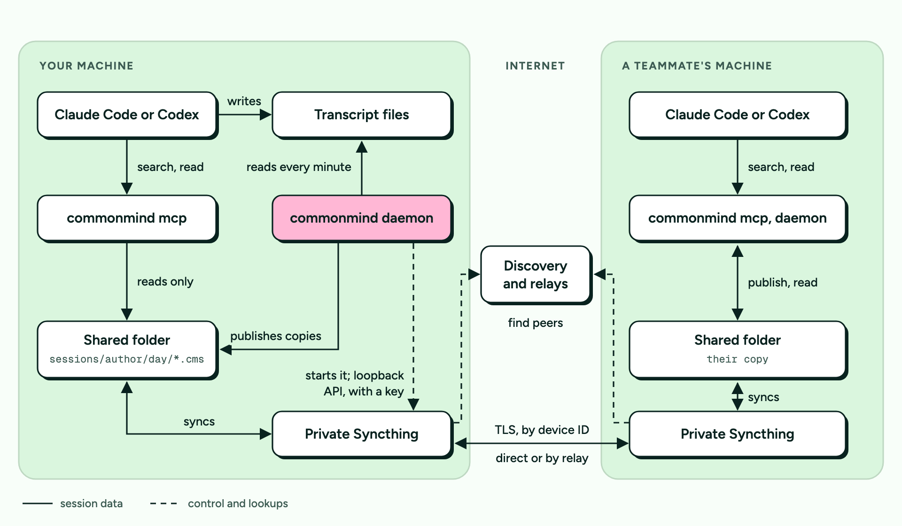

# Commonmind

**Shared memory for teams working with Claude Code and Codex.** Commonmind makes your
team's coding-agent sessions searchable from the agent you're already using, so useful
context doesn't stay on one person's laptop.

## Product summary

Coding sessions contain decisions, debugging trails and implementation details that are
hard to recover from a commit alone. Commonmind lets your agent find that work and read
the original session before you repeat an investigation or pick up a teammate's task.

Use it to:

- **Reuse past investigations:** find sessions mentioning an error, API or component.
- **Recover decision context:** read the conversation and tool output behind a change.
- **Catch up on a teammate's work:** browse sessions by author, repository or date.
- **Keep a personal archive:** use the same search tools with a local folder and no team.

Commonmind reads the transcript files Claude Code and Codex already write, publishes
copies into a shared folder, and exposes search through a local MCP server (Model Context
Protocol). Managed teams get automatic publishing and peer-to-peer sync through bundled
Syncthing. There is no Commonmind server to deploy or Syncthing UI to configure.

## How it works



Original transcripts are never modified. After enrollment, the background service scans
once per minute, including sessions still in progress. By default it considers source
files modified in the last 14 days; this is a publishing window, not a retention policy.
Previously published sessions remain until deleted. Search reads the locally available
shared files directly, so synced sessions need no indexing step and remain searchable
offline.

## Before you start

- **Supported systems:** macOS or Linux, on Intel/AMD 64-bit or ARM64. Release archives
  include Commonmind and Syncthing; Go is only needed to build from source.
- **Agent integration:** have the Claude Code CLI, Codex CLI, or both installed and
  working on your PATH for automatic MCP registration.
- **Connectivity:** keep the team creator's machine online while teammates join.
  Established peers sync whenever they overlap online; there is no always-online
  storage node. Managed services start at login using launchd or systemd.
- **Sharing scope:** the default transcript roots are `~/.claude/projects` and
  `~/.codex/sessions`, across repositories. Author labels default to your git email,
  with a user/hostname fallback.

**Transcripts are shared verbatim, including tool output, file contents and any secrets
in them.** Set roots and exclusions before creating or joining a team. Commonmind does
not redact content, and every team member can read and write the shared folder. Adding
an exclusion later does not remove files already shared. See
[exclusions and deletion](docs/operations.md#exclusions-and-deletion).

## Quick start

### 1. Install

```sh
curl -fsSL https://github.com/Mint-Security/open-kitchen/releases/latest/download/install.sh | sh
export PATH="$HOME/.commonmind/bin:$PATH"
commonmind version
```

The installer adds Commonmind to future zsh terminals automatically. For other shells,
follow its printed PATH instructions. See [shell setup details](docs/operations.md#setup-options-and-existing-installations).

### 2. Create a team, or join an existing one

**Creating a team:** choose a name and run:

```sh
commonmind init --team example
```

This creates a shared folder, starts background publishing and sync, and registers MCP
with detected agent CLIs. If you need custom roots or exclusions, include them on this
first command. For example, this alternative setup publishes only Claude Code transcripts:

```sh
commonmind init --team example --roots "$HOME/.claude/projects" --clients claude
```

To exclude a repository and its subdirectories, place a `.commonmind-ignore` file at
its root **before setup**. For working-directory glob exclusions and other choices, see
[setup options](docs/operations.md#setup-options-and-existing-installations).

**Joining a team:** run the install-and-join command your team creator sends you. It
handles installation, enrollment and MCP registration; you do not need to create a
separate team first. Publishing starts after enrollment succeeds. See
[join options](docs/operations.md#invite-a-teammate) to customize what gets shared.

### 3. Invite teammates

On the team creator's machine:

```sh
commonmind invite
```

Send the printed install-and-join command privately to teammates. It grants team access,
can be used by multiple teammates, and expires after 24 hours. Keep the creator's machine
online until they join. No verification code is required by default;
`commonmind invite --require-verification` enables one. See the
[invitation guide](docs/operations.md#invite-a-teammate) for approval and expiry details.

### 4. Verify and search

```sh
commonmind status
```

Look for `enrolled: true`, `writable: yes`, a recent `last publish attempt`, and no
`publish error`. Once eligible sessions have been published, `sessions in the shared
folder` should be nonzero. After a teammate publishes and syncs, `authors visible` should
include their author too. A fresh agent installation may have no sessions yet.

Restart your Claude Code or Codex session to load the MCP integration, then try:

> Use Commonmind to list the authors sharing sessions.

> Search Commonmind for sessions mentioning "authentication" in the last seven days.
> Read the most recent match and summarize what was tried.

> Find Dana's recent sessions in the payments repository and summarize the work.

These are prompts for your agent, which calls Commonmind's tools and summarizes the
returned transcripts. Search itself uses literal, case-insensitive text matching, with
results ordered newest first. Use concrete terms from the code or error message.

## Everyday commands

| Command | Purpose |
| --- | --- |
| `commonmind status` | Show enrollment, peers, sync backlog, publishing errors and session counts. |
| `commonmind flush` | Publish eligible sessions immediately instead of waiting for the next scan. |
| `commonmind flush --since 30d` | Also publish source transcripts modified in the last 30 days. |
| `commonmind stop` | Stop background publishing and sync; keep existing files. |
| `commonmind start` | Restart the background service and enable it at login. |
| `commonmind connect` | Register MCP with detected agent CLIs; restart the agent afterward. |
| `commonmind members` | List the team's devices and whether each is connected. |
| `commonmind remove NAME` | On the creator's machine: take a device out of the team and cancel open invites. See [removing a device](docs/operations.md#see-who-is-on-the-team-and-remove-a-device). |

The MCP tools are `search_sessions` (find or filter sessions), `list_authors` (list the
teammates sharing sessions; an author is one teammate), and `get_session` (read a
transcript). See the
[MCP tool reference](docs/mcp-tools.md) for arguments, limits and examples.

## Troubleshooting

| Symptom | What to check |
| --- | --- |
| `commonmind: command not found` | Run `export PATH="$HOME/.commonmind/bin:$PATH"` in the current terminal, or open a new zsh terminal. |
| Waiting for enrollment | Keep the creator's machine and service online. If verification is enabled, send the printed code to the creator for `commonmind approve`. If the invite expired, request a new one and rerun its join command. |
| Sync is unavailable | Run `commonmind start`, then check `commonmind status` and `~/.commonmind/daemon.log`. |
| Agent cannot see Commonmind tools | Repair or install its CLI, run `commonmind connect claude` or `commonmind connect codex`, and restart the agent session. Existing MCP entries are preserved; inspect them if they point to an older installation. |
| No sessions or expected matches | Check roots, candidate counts, skipped records and publishing errors in `status`; verify exclusions and the publishing window. Run `flush` after enrollment and allow peers to sync. Broaden search filters or try a literal term from the transcript. |

Agent registration errors do not undo team setup or stop background publishing. For
headless hosts without a user service manager, use `--no-service` and run
`commonmind daemon` under your own supervisor. See [operations](docs/operations.md).

## Limits to understand

- Search scans and decompresses files per query; broad searches cost more as history grows.
  There is no search index, semantic search or relevance ranking.
- Every team device stores the shared history. Raw transcripts can be large, and reading
  a full session is subject to your agent client's output and context limits.
- Deleting a shared file propagates when peers sync. Offline copies, backups and files
  copied elsewhere may remain. The publisher's local ledger prevents republishing;
  losing that ledger can bring deleted sessions back.
- One managed team per Commonmind home and one installed user service are supported.
  Windows service integration, cancelling one invite without removing a device, and leaving
  a team from a member's machine are not implemented.

## Documentation and development

- [Setup and operations](docs/operations.md): configuration, invitations, exclusions,
  deletion, services, and using your own shared folder.
- [MCP tool reference](docs/mcp-tools.md): search filters, reading sessions and performance.
- [Development and releases](docs/development.md): building from source, tests, installer
  checks and release automation.
- [Managed team architecture](docs/managed-teams.md): enrollment protocol and sync lifecycle.
