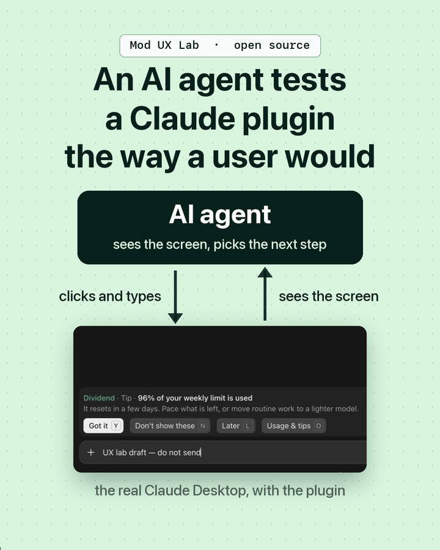

# Mod UX Lab — desktop v1

A local workbench for testing Claude Desktop mod UX. A terminal agent acts as the user, a separate Claude Desktop session is the target, and an optional critic reviews the recorded interaction. Screenshots, actions, observable checks and heuristic concerns appear together in a static HTML report.



The demo is a real `try` run of [Dividend's pane scenario](../../plugins/dividend/ux-evals/pane.json): the frames the harness captured, with the pointer and the highlights drawn on.

V1 targets macOS Claude Desktop through [Peekaboo](https://peekaboo.sh/). Node.js 22+ is the only dependency for the runner, reports and fixture tests. No server, account, telemetry or publishing is provided by Mint.

## Test a mod in Claude Desktop with one command

```sh
npm run mod-ux -- try plugins/dividend/ux-evals/pane.json
```

`try` takes one or more scenario files and, for each one:

1. Finds the plugin the scenario belongs to: the nearest folder above it with `.claude-plugin/plugin.json`, or `--plugin DIR`.
2. Copies that plugin into a marketplace of the run's own and installs it with `--scope local` in the plugin's test folder, `~/.mod-ux/workspaces/<plugin>`. Other installs of the same plugin are turned off for that folder only. Your own settings and installs are untouched.
3. Seeds the plugin's store from the scenario's `setup.store`, if it has one, so the run starts from a known state.
4. Opens **File > New Session in New Window**. The pop-out starts in the last folder you used; when that's the test folder, nothing else is needed. `try` reads the pop-out by its accessibility labels until its composer names a folder (`Folder: …`) or an environment (`Environment: …`), and captures it only once that is the test folder. Otherwise `try` closes it unrecorded, sets the folder with the `claude://code/new?folder=…` link and opens another. Claude Desktop asks whether to trust a folder every time a link brings one in: `try` says so and waits for you to click **Trust workspace** (it never answers a security question itself, and stops if the question names any other folder). The whole run happens in the pop-out, with no sidebar for the tester to wander into.
5. Starts the session in the pop-out by sending `setup.prompt` (default: "Reply with the single word OK."), because a plugin only runs once a session has a first message, and types `setup.draft` after it without sending it, if the scenario has one. Then it waits for the answer.
6. Runs the tester and the critic (`--critic none` to skip it) and writes the report to `.mod-ux/<scenario>-<time>/`, or `--out` for a single scenario.
7. Closes the pop-out, uninstalls the copy, and removes its marketplace, plugin cache and store, and the run's own temporary files (`--keep-workspace` keeps those, with the setup screenshots). The test folder stays, empty apart from its local settings, for the next run.

**Don't type or use the mouse while `try` has the focus.** Starting the session needed focus when this was tested (Peekaboo 4.9.8, Claude Desktop on macOS 26): Electron focuses a new window when it opens, Peekaboo's background press doesn't reach the composer's Send button, setting the prompt's value through accessibility brings the app forward, and a new pop-out's prompt isn't focused even when its window is. So setup is foreground input to the pop-out, while it has the focus it took: `try` clicks into its prompt (your pointer moves there), replaces anything left in it with the first message, sends it and types the draft. A `background` scenario then gives focus straight back to the app you were in, or to Claude's main window if that was it, and the rest of its input reaches the pop-out without focus or pointer. A `foreground` scenario keeps the focus until the run ends, so that nothing you type in between lands in the test window, and then gives it back. Dividend's scenarios are `foreground`, because Peekaboo's background press didn't reach their buttons either ([the tester and the input driver](#the-tester-and-the-input-driver)). When the link is needed, Claude Desktop shows it in the main window, as the new-session page; go back to your session whenever you like. These are limits of that driver on those controls, not of background input in general: Codex's Computer Use did all of the input itself (see [Let Codex drive](#let-codex-drive-in-the-background-experimental)).

**Setup checks each step.** A new-session window can open with unsent text left over from an earlier one, so the first message replaces whatever the prompt holds. `try` checks that the prompt holds exactly what it typed before it goes on; when it doesn't, `try` stops before the tester starts, says which step failed, and keeps the setup screenshots. Since setup became a foreground step, it completed in each of the four runs here.

The store seeding relies on where Claude Code keeps a plugin's `$.store` (`~/.claude/plugins/store/`), checked against Claude Code 2.1.322; it is not a documented contract. Everything else goes through `claude plugin … --json` and the `claude://` link Claude Code itself uses for `--desktop`.

## Let Codex drive, in the background (experimental)

```sh
npm run mod-ux -- try plugins/dividend/ux-evals/pane.json --driver codex
```

With `--driver codex`, Codex's own Computer Use does all of the input: it opens the test window from the menu, starts the session, types the draft and does the scenario. It presses accessibility elements directly, which needs neither the pointer nor, for an existing window, focus, and in the tested setup it pressed Claude Desktop's own controls that Peekaboo's background press doesn't reach. The harness does only what needs no input: the install for the test folder, the store, cleanup, captures of the test window, the limits and the critic's review.

This route is experimental. It depends on Codex's Computer Use and on the shape of `codex exec --json`'s event log, either of which can change with a Codex release, and it has been run against Dividend's scenarios on one Mac (macOS 26, Codex CLI 0.149.0). Without `--driver codex`, `try` depends on neither.

- **Measured, not assumed.** While Codex works, `try` logs which app is in front and where the pointer is, twice a second, into the run's `focus.json`; the result summarizes it (`claudeCameToFront`, `pointerMoves`, every change of front app). A change may be yours: the log can't tell who caused it. In the measured run, focus left the app in front once, for about six seconds, when Claude Desktop opened the test window; Electron focuses a new window when it opens, whoever asked for it.
- **Only the test window is recorded, once the harness knows which it is.** The test window is the one new window whose composer names the test folder (`Folder: ~/.mod-ux/workspaces/<plugin>`). Until one does, the harness reads each new window by its accessibility labels alone, with no screenshot, and keeps nothing; then it captures that window by its id every few seconds, and once more at the end for the checks, and closes it after the run. Windows open before the run are never read, captured or closed. If a second new window names the test folder (say you opened one yourself), the harness can't tell which one Codex used: it drops what it captured, captures and closes neither, and the run fails. A run in which no window could be identified fails the same way.
- **Other Claude windows are protected by instruction only.** On macOS, Codex's Computer Use addresses an app, not a window (in the version tested, window ids are for Linux and Windows only), so the harness can't confine Codex to the test window. Its task tells it never to screenshot, read, click or type in any other Claude window, and to read the menu bar as text only, but that is a request: in one Codex review on the tested Mac, its first screenshot was Claude's main window, not the test pop-out. The harness's own captures are limited to the test window, and the isolation check below covers tools other than Computer Use, so neither would notice Codex reading another Claude window. Close or minimize windows with sensitive content before a run.
- **Codex's own log is kept, privately.** It can contain whatever Codex saw, including another window. Its event log and final reply are copied into the run directory, as `codex-events.jsonl` and `codex-last-message.txt` (mode 0600, like the rest of the run), before cleanup removes the workspace; the run's `native` event names them. They stay out of the report and away from the critic, which sees the harness's captures of the test window only.
- **Limits and stop.** Codex's run includes the setup, so it gets the scenario's `maxDurationMs` plus 3 minutes, and its `maxSteps` plus 10 input calls; its task states both. The harness counts the input calls (clicks, scrolls, key presses, typed or set text) in the code of each Computer Use step as Codex asks for it, and stops Codex at the first call over the limit, which may or may not have taken effect; a call inside a loop counts once. Either limit ends the run as `limit`. The run's record exists from the start, so `npm run mod-ux -- stop --run <run directory>` stops Codex as well, ending the run as `stopped`. The result's `actions` gives the counts by type, with `source` saying they come from Codex's trace, setup included.
- **Checks.** The final capture decides `present` and `absent` checks. Checks tied to a click (`preserved`, `appeared`, `disappeared`) stay unassessed, because the harness doesn't see Codex's individual clicks; Codex's steps are in the report as text.
- **Computer Use and nothing else.** Without help, `codex exec` loads your whole Codex setup: its MCP servers, app connectors, memories, hooks and standing instructions, which may tell it to log work to a tracker. A test run switches all of that off for the run only, with `-c mcp_servers.<name>.enabled=false` for every server except `cua_repl` (Computer Use) and `--disable apps,memories,hooks,…`, and gives Codex's own shell a read-only sandbox (no writes, no network). `try` lists Codex's servers again with those flags and refuses to start unless only Computer Use is left; your Codex configuration file is never changed. Afterwards, any action outside Computer Use (another tool, a shell command, a file change, a web search) is reported as an isolation breach and fails the run. Codex still reads your standing instructions; the task tells it to ignore any about tickets or notes, and it has no tool left to follow them with. Computer Use itself runs JavaScript outside Codex's sandbox, so this keeps Codex away from your accounts, not from your Mac.
- **Keys that arrive twice.** Codex's Computer Use service attaches keyboard taps to the app it drives, and has been seen keeping them after a run ends, so that every key typed in Claude Desktop arrived twice. `try` won't start while another program holds keyboard taps on Claude, and fails a run that leaves any behind (exit 1), naming the program. Quitting and reopening Claude Desktop clears them.
- **Only OpenAI's signed Codex runs.** `try` takes the first `codex` on `PATH` (or `MOD_UX_CODEX`) that is signed with OpenAI's Developer ID (team `2DC432GLL2`) and whose signature verifies with `codesign --verify --strict`. It passes over and names anything else, such as npm's JavaScript launcher, an ad-hoc signed build, or one whose contents no longer match its signature, and stops if nothing qualifies. The result names the binary it ran. (A Node version manager can put an old npm-installed `codex` ahead of Homebrew's.)
- **Model.** Codex uses your Codex configuration; pass `--codex-model` to override it (a ChatGPT login can refuse some models in the CLI). Screenshots of the test window go to OpenAI.
- **The test folder.** The new window starts in the last folder you used. If that isn't the test folder, Codex stops as blocked rather than changing it; start one new session in `~/.mod-ux/workspaces/<plugin>` yourself, or run once without `--driver codex`, and later runs find it.

## The tester and the input driver

Two separate parts act on the desktop. The **tester** (`--actor`: Claude, or any command) only chooses the next action. The **input driver**, Peekaboo, delivers it. Which model tests, and whether you launch the CLI from a terminal, a background process or another agent, doesn't change how input is delivered.

| Scenario `target.interactionMode` | How input reaches the window | Your pointer and front app |
|---|---|---|
| `background` (the default) | Accessibility actions on an element; `click_point` as an accessibility press at a window-relative point; typing and keys to the window when it holds the app's keyboard focus, otherwise typing sets its one text field's value | Untouched, except that setting a value in Claude Desktop brings it forward |
| `foreground` | Focuses the target window and synthesizes shared input (`--foreground --input-strategy synthOnly`) | Taken over until the run ends, when `try` gives focus back; don't use the Mac meanwhile |

Electron nests Claude Desktop's controls deep in its accessibility tree. With Peekaboo 4.9.8's default traversal limits, only the window chrome was visible in testing, which looks like an inaccessible app; the driver passes `--depth 80 --max-elements 3000 --max-children 500`, which reached the prompt box (with its value) and a plugin's buttons. A control that is still missing can be reached with `click_point` if the scenario allows it. In the background, both kinds of click are accessibility presses, so they reach only controls that accept one. In the tested setup (Peekaboo 4.9.8, Claude Desktop on macOS 26), Claude Desktop's own controls didn't, in `try`'s pop-out: not the composer's (Send, the folder picker), not the trust dialog, and not a plugin's buttons. Peekaboo's debug log showed why for Dividend's **Usage & tips**: its direct press of the element failed (`actionUnsupported`), and its fallback, a press of whatever accessibility element is at the element's point, found nothing pressable there. In one of those runs the typed draft was sent during that click, for a reason not found. Passing `--input-strategy actionOnly` didn't change this: Peekaboo's helper app does the click and keeps its own strategy. In `foreground` mode the same click is a real one at the element, and opened Dividend's pane. The driver never upgrades a background run to foreground on its own.

This harness's Claude adapter is a tester and critic model; Peekaboo, or Codex with `--driver codex`, delivers the input. It doesn't use Claude's own computer use.

### Review with a native controller on its own

Codex and Claude can also operate apps themselves, with no harness involved. They collect their own screenshots and notes, with no harness trace, checks or report, and a controller's statement that it finished is not a harness pass. With `--driver codex`, Codex is instead the input driver for a harness run ([Let Codex drive](#let-codex-drive-in-the-background-experimental)).

- **Codex**: per [its documentation](https://learn.chatgpt.com/docs/computer-use), Computer Use can work in the background on macOS; on Windows it uses the active desktop.
- **Claude Desktop**: per [its documentation](https://support.claude.com/en/articles/14128542-let-claude-use-your-computer-in-cowork), working in the background is the default on macOS 15 or later. If it keeps taking over the screen, check that **How Claude uses the apps you allow**, under Computer use in Settings, isn't set to **Full control**. That setting doesn't affect Peekaboo.
- **Claude Code's CLI**: its built-in `computer-use` MCP server, enabled through `/mcp`, hides other visible apps while it works, allows one session at a time, and isn't available with `-p` ([documentation](https://code.claude.com/docs/en/computer-use)).

None of these was tested here for window isolation, apart from the Codex observation above. Naming the test window in the task is a request, not a guarantee, so close or minimize windows with sensitive content first. Copy the scenario's goal, constraints, allowed actions and limits into the task; for discoverability, keep the checks and the plugin's code out of it. For example:

```text
Use your native Computer Use tools to review the prepared Claude Desktop window on macOS.
Work only in the Claude Desktop window titled "[test window title]". Do not capture, click or type in any other window.
Use background app control only. Stop and explain if an action needs foreground or shared input.
Task, constraints and allowed actions: [copy from the chosen scenario].
Action and time limits: [copy from the chosen scenario].
Record actions and before/after screenshots under .mod-ux/native-review/.
Separate observed failures, possible UX friction and checks you could not assess.
Do not start a mod-ux run or call mod-ux act.
```

## Try the complete pipeline without a model

From the repository root:

```sh
npm run mod-ux -- demo --out .mod-ux/injected-bug
npm run mod-ux -- demo --control --out .mod-ux/good-control
```

Open either run's `report.html`. The synthetic buggy interface deliberately loses the draft when the usage pane opens. The preservation check fails with links to the before frame, action and after frame. The control preserves the draft and passes. These images are generated fixtures, **not screenshots or findings from Claude Desktop**. The scripted tester in this demo does not exercise the model adapter. The demo command exits successfully after producing its expected findings.

```sh
npm run test:mod-ux
```

The fixture suite runs on Linux/macOS without desktop permissions, model credentials or network. CI runs it alongside lint.

## Prepare the desktop driver

Install the signed CLI from its [official source](https://peekaboo.sh/install.html):

```sh
brew install openclaw/tap/peekaboo
peekaboo --version
npm run mod-ux -- doctor
```

The adapter was developed against Peekaboo **4.9.8**. It requires producer-bound `ps1_…` snapshots, `--fresh`, `snapshot_reusable` and `mutation_targeting_available` evidence. It refuses older/partial observations instead of using a global input fallback. An alternative executable can be supplied with `MOD_UX_PEEKABOO=/absolute/path/to/peekaboo`.

To pin the signed companion host for a background runner, set `PEEKABOO_BRIDGE_SOCKET` to its `~/Library/Application Support/Peekaboo/bridge.sock` path. The selected path is saved with new runs. It must belong to a healthy, authorized Peekaboo host. This picks the process that delivers input; it doesn't create a separate desktop or change the scenario's interaction mode.

Peekaboo needs Screen Recording and Accessibility permission for its selected execution host. Follow [its permission instructions](https://peekaboo.sh/permissions.html); a background terminal may require the signed Peekaboo companion/Bridge host. Grant permission only after reviewing which executable/host receives it. The harness does not request, grant or bypass OS permissions. `doctor` prints the driver's reported status without capturing a screen. A successful diagnostic alone does not establish that observation/input works.

## Prepare a disposable Claude Desktop session

`try` does all of this for you. These steps are for `start` and `run`, which attach to a session you prepared:

1. Open Claude Desktop's **Code** mode in a disposable workspace/session, with the mod under test installed and the initial state required by your scenario.
2. Finish or pause unrelated work in that window. Close dialogs and search overlays. Do not use a production task as the target.
3. Leave only one eligible Claude window, or select an exact ID:

```sh
npm run mod-ux -- windows
```

V1 attaches to an existing window. It does not create/reset a conversation, install mods, select a repository or cancel target-agent work. The entire selected window may be recorded, including its sidebar. Choose the target accordingly.

## Let a terminal Claude test it

The built-in `claude` adapter uses your installed, authenticated Claude Code CLI. It runs with `--safe-mode`, no tools, no MCP servers, no slash commands and no session persistence. Screenshots are passed directly as image blocks; it does not get shell/file/computer tools. The runner performs each validated desktop action separately. The adapter's minimum supported version is **2.1.322**, its tested baseline; newer versions must retain these flags and structured output. Plugin compatibility CI pins **2.1.291** for Dividend and Pair and does not run the live model adapter. Harness tests exercise the adapter's protocol with stubbed subprocess responses.

```sh
npm run mod-ux -- run path/to/your-mod/ux-evals/discovery.json \
  --out .mod-ux/current \
  --actor claude --critic claude \
  --call-budget-usd 0.50
```

Add `--window 12345` when needed, and `--model MODEL_ID` to choose a model. Model calls send the supplied goal, visible accessibility text, screenshots and interaction history to that agent's provider. This is not an offline evaluation. The critic receives the trace plus at most six explicitly indexed frames; it is not a frame-by-frame video review.

`--call-budget-usd` is passed to each terminal-Claude invocation. It is **not a shared billing cap**: there can be one tester invocation per action plus a final completion assessment and a critic, provider enforcement can overshoot an individual request, and target Claude Desktop usage is separate. Generic command agents manage their own billing. After the last permitted action, the tester can assess the resulting frame and say done or blocked; another requested action ends the run as `limit` without dispatching input. The interaction-duration and per-agent timeouts still apply to that final assessment.

To stop the harness from another terminal:

```sh
npm run mod-ux -- stop --run .mod-ux/current
```

Ctrl-C also stops an automated run. Cancellation signals the tester/driver subprocess group, escalates to SIGKILL after 500 ms and closes inherited pipes so a detached descendant cannot keep the call pending. A descendant that deliberately leaves the group is outside this termination guarantee. Input already delivered may have an effect. **Neither command cancels work already executing inside Claude Desktop.** The interaction deadline bounds the tester/target loop; an optional final critic has its own agent timeout.

## Use the controller directly from another terminal agent

These commands use the same Peekaboo driver and scenario mode as `run`, whichever assistant calls them. For an assistant's own computer use, see [Review with a native controller on its own](#review-with-a-native-controller-on-its-own).

```sh
npm run mod-ux -- start path/to/your-mod/ux-evals/discovery.json \
  --out .mod-ux/manual
npm run mod-ux -- observe --run .mod-ux/manual
```

Use the returned screenshot and accessibility elements. Copy a real element ID and the latest observation ID into one action:

```sh
node tools/mod-ux/cli.mjs act --run .mod-ux/manual \
  --observation e0002 --action '{"type":"click","element":"ID_FROM_OBSERVATION"}'
```

`act` returns the **new** observation; use its IDs next. Every action consumes its observation. Stale/expired references and concurrent writers are refused. Input failures stop the session without an automatic retry. If a process crashes with `.lock` present, first ensure it and its children have exited, then remove that run's lock manually. When an unfinished run is reopened after a crash, orphaned pending actions are marked uncertain and the run is blocked before any command proceeds. Fresh observations may inspect that blocked run but cannot unlock input. Inspect the actual UI before starting a new run; the old action is never replayed.

Resume only run directories you created and trust. Saved `session.json` includes executable and companion-socket paths that the controller reuses for observation/input; resuming an unfinished run from someone else can execute their configured program with your environment.

Observations read the accessibility tree deeply enough for Claude Desktop's controls (see [the tester and the input driver](#the-tester-and-the-input-driver)). Where a control is still missing, a scenario can allow `click_point`: in background mode it is an accessibility press at a window-relative point in the exact window, without moving the pointer, so it reaches only controls that accept one; with `target.interactionMode` set to `foreground` it focuses the window and uses the shared pointer instead. The driver never silently retries a failed background action in foreground mode.

```sh
node tools/mod-ux/cli.mjs finish --run .mod-ux/manual \
  --status completed --summary 'Manual tester completed the task.'
```

Direct `node` invocations produce clean JSON stdout, without npm's script banners.

The JavaScript session APIs `createSession`, `capture`, `applyAction`, `finishSession`, `reviewSession` and `runLoop` take named parameter objects. For example, `applyAction({ directory, session, driver, action, observationId, signal })` makes the run context and optional cancellation explicit. Shared JSDoc contracts in [`src/options.mjs`](src/options.mjs) define accepted session, subprocess, driver and agent options; functions reference those definitions rather than leaving forwarded options undocumented.

Supported actions:

| Action | Fields | Notes |
|---|---|---|
| `click` | `element` | Must come from the current observation |
| `click_point` | `x`, `y` | Normalized 0–1 screenshot point; needs a provider-owned exact-window coordinate mapping. Background by default (pointer untouched); focused shared input only in `foreground` mode |
| `type` | `text` | Single literal line; no control characters or interpreted control escapes |
| `press` | `key` | One macOS chord, such as `return`, `escape`, `cmd+a`; scenario must permit it |
| `scroll` | `element`, `direction`, `amount` | Targeted element, 1–20 units |
| `wait` | `ms` | 0–10,000; followed by a fresh capture |

A scenario can omit `press` to prevent Return submission through that action and instruct the tester not to submit, approve tools or leave the prepared session. These restrictions are not a complete security policy: clicking a visible Send button can still have effects. Use isolated accounts/workspaces and task-appropriate action restrictions. V1 does not provide an OS sandbox or semantic authorization for every clickable control.

Typing accepts the provider's documented dispatched-but-unverified outcome, then always captures a fresh observation. This is not confirmation that text arrived; the tester must inspect the frame before taking another action. An uncertain error still stops the run without a retry.

## Scenarios and observable checks

Each adopter owns its versioned JSON scenarios, for example under `your-mod/ux-evals/`. This keeps desktop scenarios separate from `claude plugin eval`'s `evals/` cases. The CLI takes an explicit file path; it does not load a default mod or discover cases inside the tool. Keep product-specific goals, selectors, state preparation and evaluation results with that product. The commands above use a placeholder path: replace it with your own scenario file.

The harness owns its synthetic fake desktop and good/bad controls under `tests/fixtures/`. Those fixtures test the evaluator itself and power `demo`; they are not evaluations of a real mod.

Use the following as a starting point for a consumer-owned scenario and replace the goal and selectors with your mod's actual task and visible labels. Selectors are exact matches on visible `role`, `label` and/or `value`, not implementation identifiers.

```json
{
  "version": 1,
  "name": "Draft survives a mod pane",
  "goal": "Write an unsent draft, inspect the mod and return to the draft.",
  "target": { "app": "com.anthropic.claudefordesktop" },
  "allowedActions": ["click", "type", "wait"],
  "checks": [
    {
      "id": "draft-preserved",
      "kind": "preserved",
      "selector": { "label": "Prompt" },
      "after": { "label": "Your mod details" }
    }
  ],
  "limits": {
    "maxSteps": 20,
    "maxDurationMs": 300000,
    "agentTimeoutMs": 60000,
    "maxObservationAgeMs": 120000
  }
}
```

- `present` / `absent`: check for an exact selector in the final captured accessibility observation.
- `preserved`: compare a uniquely identified element's value before/after each click matching `after`. An unexercised trigger or missing/ambiguous value is **unassessed**, not passed. Equal empty values do not prove a meaningful draft was tested; the scenario must create the intended state.
- `appeared` / `disappeared`: require a confirmed click matching `after`, with the selector changing from absent to present or present to absent across that click's recorded frames. Missing prerequisites, uncertain input and insufficient accessibility coverage remain **unassessed**. A dispatched click with adequate evidence but no expected transition fails. These checks do not infer a transition from the final frame alone. For example, `{ "id": "tip-dismissed", "kind": "disappeared", "selector": { "label": "Dismiss tip" }, "after": { "label": "Dismiss tip" } }` requires seeing that control before its click and seeing it removed afterward.
- `after` may also be a list of selectors, any one of which counts as the trigger, for one entry point that carries different labels in different states: `"after": [{ "label": "Open details" }, { "label": "Details" }]`.

Use transition checks to establish that a task was exercised, then final-state checks to establish how it ended. A final draft that already existed or an absent tip that was never shown cannot establish a successful interaction by itself. Screenshot point clicks without semantic trigger evidence cannot satisfy a check keyed to an accessibility label.

The tester receives the goal, constraints, current image/elements, allowed actions and its interaction history. It does not receive checks, the variant label, native receipts or plugin source. The critic sees evidence and checks after the interaction. Findings must reference existing event IDs and remain labeled **heuristic concerns**.

Sparse accessibility maps are explicitly marked; with the driver's traversal limits Claude Desktop is not one, but other surfaces can be. A selector missing from such a map is **unassessed**, because a visible control may be omitted by the platform. The critic can review the screenshot, but its interpretation remains a separate heuristic judgment. Reports include action counts and separate tester/critic model time, capture overhead, input overhead and requested waits. Pure application latency, human annoyance and transient interruptions between frames are not inferred from these totals.

`completed` means the tester said it finished. Check results, harness errors and critic availability are reported separately. `run` and manual `finish` exit nonzero for blocked/error/limit/stopped sessions, unresolved input, failed configured checks or unavailable critics. A finish request cannot replace a harness failure with completion: the actual status and error remain visible, and the requested status/summary are retained separately as `finishRequest`. Finalized interaction status, finish time, frames and checks cannot be overwritten. Repeated `stop` preserves those artifacts; further `observe` or `finish` calls are refused. A critic may still add its separate review after interaction finalization. Unassessed checks are explicit in JSON/HTML and do not establish UX success.

Exploratory runs may complete with unassessed checks and exit 0. For an acceptance or CI gate, add `--require-assessed` to `run` or `finish`: exit **0** requires at least one check and every check passed; exit **2** means checks are missing or unassessed; exit **1** takes precedence for a run failure, failed check, unresolved input or unavailable critic. An incomplete run or harness error takes priority over check results in the report headline.

For A/B work, prepare separate sessions with the desired mod/version and run the same scenario with `--variant mod-off`, `--variant current` or `--variant candidate`. These are labels only: **the runner does not toggle mods**. Keep host versions, initial state, workspace, viewport and task matched. V1 does not provide statistical comparisons or deterministic live-model replay.

## Bring another tester or critic

A different tester changes who decides, not how input is delivered: every action still goes through the input driver and the scenario's mode. Only `try --driver codex` changes the input driver; a Codex CLI passed as `--actor` is a tester like any other, with Peekaboo delivering its actions. Pass a JSON argv array instead of `claude`:

```sh
node tools/mod-ux/cli.mjs run scenario.json --out .mod-ux/custom \
  --actor '["node","/absolute/path/to/my-tester.mjs"]' \
  --critic '["node","/absolute/path/to/my-critic.mjs"]'
```

Each invocation receives one JSON document on stdin and must emit one JSON document on stdout. Put logs on stderr. No shell is involved; use absolute script paths because agents run in an empty `agent-work` directory. The command you configure is trusted local code and inherits your environment; only the built-in Claude adapter disables its own tools/customizations.

A tester returns one of:

```json
{"status":"act","reason":"Open usage information","action":{"type":"click","element":"CURRENT_ELEMENT_ID"}}
```

```json
{"status":"done","reason":"Visible evidence that the goal was reached."}
```

```json
{"status":"blocked","reason":"The mod's entry point is not discoverable."}
```

A critic returns:

```json
{
  "summary": "One possible interruption needs review.",
  "findings": [{
    "title": "Draft disappeared after opening the pane",
    "severity": "high",
    "description": "The before frame contains a draft; the after frame is empty. The trace does not establish the underlying cause.",
    "evidence": ["e0004", "e0006", "e0007"]
  }]
}
```

## Artifacts, fidelity and current limits

Every run directory contains `session.json`, `result.json`, `report.html` and captured frames. State is written before dispatching input so an uncertain action cannot silently be retried. Each observation/action has an ID, timestamp and duration. Tester/model time is separate; capture/input durations include driver overhead and are not pure host latency. Artifacts contain screen content and entered text and are ignored by Git under `.mod-ux/`. They are not automatically redacted.

Before creating a run or capturing a screen, `start`, `run` and `demo` check the output destination with Git, resolving existing symlink parents. A destination inside a work tree must be ignored; use `.mod-ux/` or add an ignore rule for a custom directory. A destination outside Git is allowed. `--allow-unignored-output` explicitly bypasses this check, including when Git is unavailable. It does not redact captures or prevent a later manual upload.

V1 provides the complete observation → action → evidence → check/review loop. It does not yet provide a fixture browser for real native mod states, host hook telemetry, automatic resets, resizing, cross-host support, long-session workload replay, statistical A/B analysis, CI access to a real signed-in desktop, or human-calibrated annoyance estimates. AX and pixels can be captured at different moments; neither should be treated as an atomic host state. Test known-bad and good controls and review findings with people before relying on new heuristics.

The native plugin test kit remains valuable for cheap component/event regressions. This harness exercises the actual desktop host when its driver is permitted to run; it does not replace those tests.
